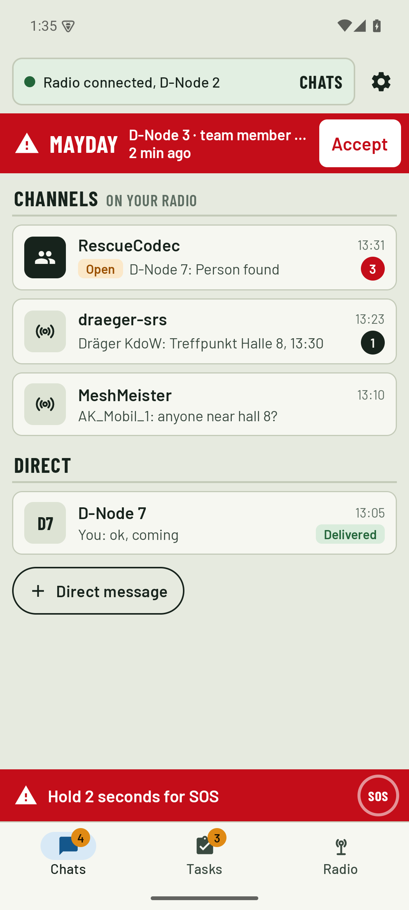
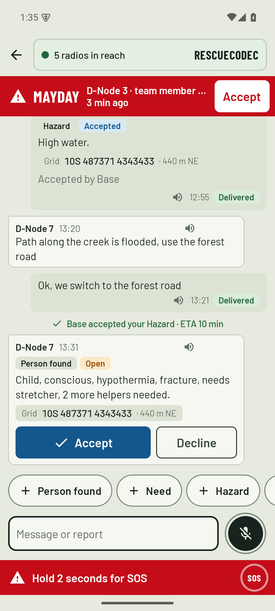
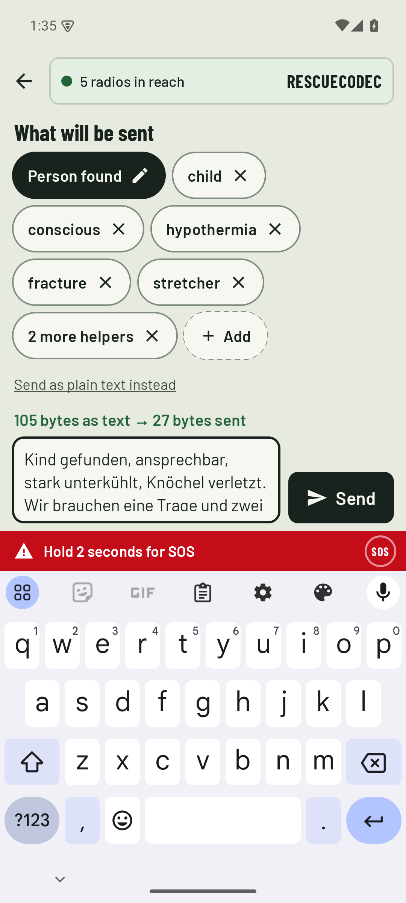
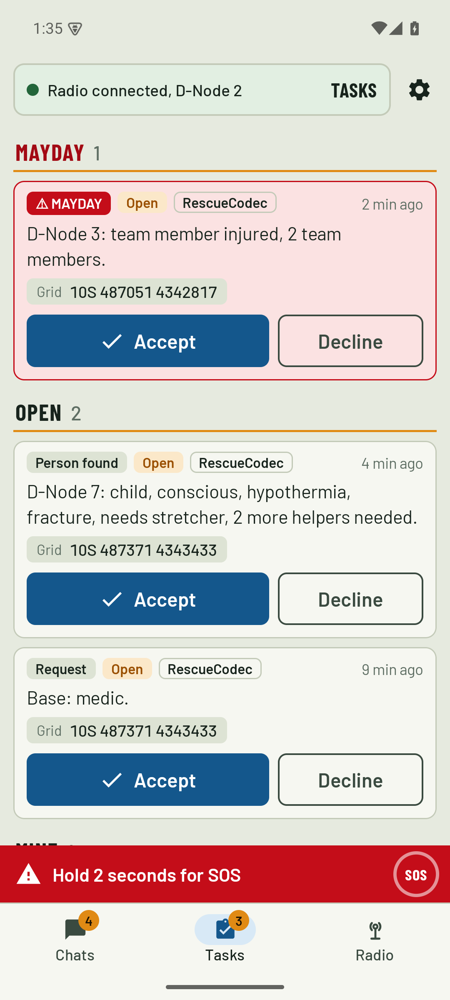
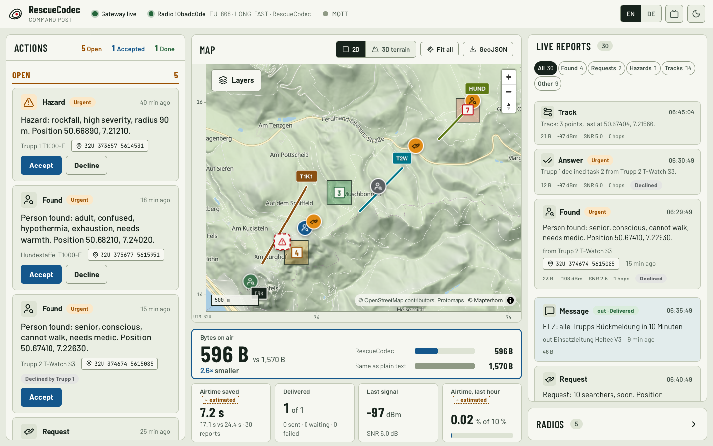

# RescueCodec

**Transmit meaning, not words.**

RescueCodec is a messenger for outdoor rescue teams and volunteers. It runs over the Meshtastic LoRa radio mesh, so it needs no internet and no phone signal.
A rescuer types or says one sentence. The app turns it into about 20 bytes, and the command post sees it on a map and answers.

Built at the Hackathon@PMRExpo 2026 in Köln. This is a prototype, not a certified emergency system.

<p align="center">
  
  
  
  
</p>
<p align="center"><em>The Android app: chats, a team channel, writing a report, tasks.</em></p>

<p align="center">
  
</p>
<p align="center"><em>The command post dashboard: tasks, offline map with tracks and finds, live reports. The send panel: <a href="docs/screenshots/dashboard/send-panel.png">screenshot</a>.</em></p>

## An example

A rescuer in the forest types or says:

> Kind gefunden, ansprechbar, stark unterkühlt, Knöchel verletzt. Wir brauchen eine Trage und zwei Leute.

As text that is 105 bytes. RescueCodec sends 23 bytes, GPS position included. The command post reads:

> Person found: child, conscious, hypothermia, fracture, needs stretcher, 2 more helpers needed.

The operator clicks **Accept**. An answer of about 20 bytes goes back, and every phone on the channel sees who took the task.

## What it does

- **Chats like a messenger.** One chat per radio channel, plus direct messages to one person.
- **Reports from one sentence.** German or English. Simple offline rules turn the sentence into chips (child, conscious, stretcher). You check the chips, then send.
- **Tasks with Accept and Done.** Every found person, request or hazard becomes a task. Hold **SOS** for 2 seconds to send a Mayday. It goes first in the queue and shows as a red banner on every screen.
- **Works with normal Meshtastic.** Stock Meshtastic radios carry the messages. We change nothing in the firmware. People with the official Meshtastic app get normal text. Between RescueCodec users, free text is packed with a shared dictionary and is about 43 % smaller.
- **Compact text (opt-in).** Settings, "Use compact encoding for text messages": every known English word becomes a 2-byte code, and names, numbers, coordinates and emoji are copied byte for byte, so the receiver sees exactly what was typed. Off by default. Details and numbers: [docs/COMPACT_TEXT.md](docs/COMPACT_TEXT.md).
- **Team vocabularies.** With compact text on, pick Emergency, Search & Rescue, Firefighting, Hiking / Mountain or Medical / First aid, or Auto (the default, tries every list). Common words of that work cost 10 bits instead of 2 bytes: "Apply a tourniquet." is 7 bytes instead of 19 as normal text. The app sends the strictly smallest form, so a list never makes a message bigger.
- **Channels by QR code.** Create a private channel on the phone, show its QR code, and teammates join by scanning it.
- **Command post dashboard.** Offline map with finds, tracks and hazards, a task board, live reports with a channel filter, and a send panel that shows the size before you send.
- **Open for other software.** The gateway offers REST, WebSocket, MQTT, TAK (Cursor on Target) and GeoJSON. Libraries in Python, Kotlin and TypeScript give the same bytes.
- **Offline voice.** Speech to text on the phone (Vosk) and read-aloud. No internet needed.
- **Notifications with sound.** For new messages, new tasks, a Mayday (loud) and answers to your own reports.

## Honest numbers

Byte counts are measured. Airtime is calculated with the LoRa formula for the LONG_FAST preset (EU 868 MHz), including Meshtastic's own header.

| What | As text | RescueCodec | Gain |
|---|---|---|---|
| The example sentence, with GPS | 105 B, 1.21 s on air | 23 B, 0.60 s on air | 4.6× fewer bytes, about 2× less airtime |
| All messages of our real-radio test on 25 Nov | | | 1.9× fewer bytes |
| Free text, packed (40 test messages not used for tuning) | | | 43 % smaller (German 44 %, English 43 %) |
| Compact text (2-byte words, compact frame, dictionary 2), 2,357 disaster messages not used to build the dictionary | | | 61 % smaller (2.4 bytes per word), 100 % fit one radio packet; Meshtastic adds about 23 B per packet on air (see below) |
| Compact text, 4,998 everyday English sentences not used to build the dictionary ("hello world": 6 B instead of 11) | | | 61 % smaller (2.0 bytes per word), 99.7 % go compact, 0.3 % stay plain text because that is smaller |
| Team vocabularies (10-bit words, domain frame), 14,421 domain sentences and messages not used to build the lists | 5.91 B per word | 2.26 B per word (compact text alone: 2.37) | 4.9 % fewer bytes than compact text alone; 6 to 12 % on field-manual sentences, under 3 % on messages, under 1 % on everyday chat. 18 KB in the APK. [Details](docs/COMPACT_TEXT.md#domain-vocabularies-spec-23) |

**Why is the airtime gain smaller than the byte gain?** Meshtastic adds about 23 bytes to every packet (a 16-byte radio header plus its `Data` wrapper), and every LoRa packet starts with the same preamble. The airtime numbers use these 23 bytes. So 23 bytes of content are about 46 bytes on air. The gain grows when more facts share one packet, for example a GPS track of 10 points in 48 bytes.

In the app the example report shows as 23 to 27 bytes, depending on the message number and the position. All sizes per message type: [spec/SPEC.md, section 9](spec/SPEC.md#9-sizes-measured).

## How it works

```
 FIELD                                                COMMAND POST

 Phone with the RescueCodec app
        |
        |  Bluetooth
        v
 Meshtastic radio  ~~~~~ LoRa mesh, 868 MHz ~~~~~  Meshtastic radio
 (ThinkNode M5, T1000-E)                           (Heltec V3)
                                                         |
                                                         |  USB
                                                         v
                                              rescuecodec-gateway (laptop)
                                                         |
                    +----------------+-------------------+--------------+------------+
                    |                |                   |              |            |
                dashboard     REST + WebSocket          MQTT           TAK        GeoJSON
```

1. The app reads the sentence with simple offline rules and turns it into codes: child, conscious, needs stretcher. The person checks the chips and taps Send.
2. The codes are packed with protobuf into about 20 bytes and sent as one Meshtastic packet on a private channel. The channel key encrypts it.
3. Normal Meshtastic radios carry the packet through the mesh. Other radios in range repeat it.
4. At the command post a radio on USB hands the packet to the gateway. The gateway decodes it, shows it in German or English, and makes a task.
5. When the operator clicks Accept, a short answer goes back the same way to every phone on the channel.

More detail: [docs/ARCHITECTURE.md](docs/ARCHITECTURE.md). Every byte and rule: [spec/SPEC.md](spec/SPEC.md).

## Get started

**What you need.** Two or more Meshtastic radios on stock firmware 2.7 or 2.8 (tested: a ThinkNode M5 with the phone, a Heltec V3 on USB at the gateway; the guides also cover the SenseCAP T1000-E and the LilyGO T-Watch S3), an Android 8 or newer phone, and a laptop (macOS tested, Linux should work). The demo below needs no radio and no phone.

**With radios and phones.** [docs/SETUP.md](docs/SETUP.md) runs everything from the team's Mac, step by step. On your own laptop, from a fresh clone, start with [docs/SETUP-NEW-DEVICE.md](docs/SETUP-NEW-DEVICE.md): it also gets the app file and the offline map, which are not in git.

**Try it in 2 minutes, no radio needed** (Python 3.10 or newer):

```bash
python3 -m venv .venv && .venv/bin/pip install -e '.[gateway,test]'
.venv/bin/rescuecodec-gateway --emulator --emulator-demo --db :memory:
```

The first install needs the internet. Then open http://127.0.0.1:8000/ in your browser (port 8000 busy? add `--port 8765`). A pretend team sends reports every few seconds. Click **Accept** on a task, then **Done**. The API docs are at http://127.0.0.1:8000/docs.
The map stays blank until you fetch the offline map once ([docs/SETUP-NEW-DEVICE.md](docs/SETUP-NEW-DEVICE.md), part C).

**Use it in your own code.** The example sentence in Python:

```python
from rescuecodec.engine import extract
from rescuecodec.v2 import encode, decode_any, render

report = extract("Kind gefunden, ansprechbar, stark unterkühlt, Knöchel verletzt. Wir brauchen eine Trage und zwei Leute.")
data = encode(dict(report.message, id=7, pos={"lat": 50.69212, "lon": 7.21345}))
print(len(data))                        # 23
print(render(decode_any(data), "en"))   # Person found: child, conscious, hypothermia, fracture, ...
```

Kotlin, TypeScript, REST, WebSocket, MQTT, TAK, GeoJSON and the Android Intent: [docs/INTEGRATE.md](docs/INTEGRATE.md).

## Repository

| Folder | What | Licence |
|---|---|---|
| `android/app` | The Android app (Kotlin, Jetpack Compose, Meshtastic SDK, offline speech) | GPL-3.0 |
| `android/codec`, `android/engine` | Kotlin libraries: codec, sentence rules, send queue | Apache-2.0 |
| `dashboard/` | Command post web page (React, MapLibre, offline map) | Apache-2.0 |
| `rescuecodec/` | Python package: codec, sentence rules, send queue and the gateway | Apache-2.0 |
| `ts/` | TypeScript library `@rescuecodec/core` | Apache-2.0 |
| `spec/` | The open spec: protobuf file, JSON shape, word lists, translations, test vectors, OpenAPI | Apache-2.0 |
| `sim/` | Three real Meshtastic nodes in Docker, for tests without radios | Apache-2.0 |
| `hil/` | Read-only checks for the real radios | Apache-2.0 |
| `scripts/` | Setup helpers, end-to-end tests, screenshots | Apache-2.0 |
| `tests/` | Python tests | Apache-2.0 |
| `docs/` | Guides, design notes, screenshots | |
| `legacy/v1/` | The team's first prototype, kept for reference | |

Each part has its own README: [android/app](android/app/README.md), [android/codec](android/codec/README.md), [android/engine](android/engine/README.md), [ts](ts/README.md), [dashboard](dashboard/README.md), [gateway](rescuecodec/gateway/README.md), [sim](sim/README.md).

## Docs

| File | What |
|---|---|
| [docs/SETUP.md](docs/SETUP.md) | Run everything from the team's Mac: radios, gateway, dashboard, phones |
| [docs/SETUP-NEW-DEVICE.md](docs/SETUP-NEW-DEVICE.md) | Set up another laptop from zero |
| [docs/HARDWARE_CHECK.md](docs/HARDWARE_CHECK.md) | 10-minute checklist for real radios, with fixes when something fails |
| [docs/INTEGRATE.md](docs/INTEGRATE.md) | Use RescueCodec from your own software, with examples that were run |
| [docs/ARCHITECTURE.md](docs/ARCHITECTURE.md) | How the parts fit together and why |
| [docs/COMPACT_TEXT.md](docs/COMPACT_TEXT.md) | Compact text with 2-byte word codes and team vocabularies: wire format, word list sources, measured results |
| [docs/VOICE.md](docs/VOICE.md) | Offline speech to text and read-aloud |
| [docs/OFFLINE.md](docs/OFFLINE.md) | Every download, its size and its licence |
| [spec/SPEC.md](spec/SPEC.md) | The spec: wire format, JSON, rules, test vectors, security |
| [docs/design/](docs/design/) | Dashboard design notes and the app mockup. App design notes: [android/app/DESIGN.md](android/app/DESIGN.md) |
| [docs/screenshots/](docs/screenshots/) | Screenshots of the app and the dashboard |

## Tests

```bash
.venv/bin/python -m pytest -q                       # Python: 454 tests
(cd ts && npm install && npm test)                  # TypeScript library: 489 tests
(cd dashboard && npm install && npm test)           # dashboard: 68 tests
. scripts/env.sh && (cd android && ./gradlew :codec:test :engine:test :app:testDebugUnitTest)   # Kotlin and the app
scripts/e2e-full.sh --runs 1                        # app on the emulator, simulator, gateway, dashboard
```

All of them pass today. The Python, Kotlin and TypeScript libraries run the same test vectors in `spec/vectors/` and must give the same bytes. The app unit tests need Java 21 or newer. The end-to-end test needs Docker and the Android emulator.

## Contributing

- **Run the tests** above before you send a change. All of them must pass.
- **Never edit the test vectors by hand.** `spec/vectors/codec.json` comes from `spec/tools/gen_vectors.py`, `spec/vectors/domain.json` from `spec/tools/gen_domain_vectors.py`. Change the cases in the script and run it, for example `.venv/bin/python spec/tools/gen_vectors.py`. `gen_domain_vectors.py --check` only compares. Add cases; never change the bytes of a case that was released.
- **Same bytes everywhere.** Python, Kotlin and TypeScript must give the same bytes for every vector. A change to the wire format goes into `spec/SPEC.md` and into all three libraries in the same change.
- **Never make a library pass by changing a vector.** Report a bug instead (SPEC section 12).

## Licences

- **Apache-2.0** ([LICENSE](LICENSE)) for the spec, the libraries (Python, Kotlin, TypeScript), the gateway and the dashboard. Anyone can use them in open or closed products.
- **GPL-3.0** ([android/app/LICENSE](android/app/LICENSE)) for the Android app, because the Meshtastic Kotlin SDK it uses is GPL-3.0. To build a closed app, use our Apache-2.0 Kotlin libraries with your own radio code, or call our app with an Intent ([docs/INTEGRATE.md](docs/INTEGRATE.md)).
- The gateway talks to the radio through the `meshtastic` Python library, which is GPL-3.0. It is an optional install (`.[gateway]` or `.[radio]`) and is not part of this repo.
- Map data, fonts and speech models have their own licences (ODbL, OFL, Apache-2.0). See [docs/OFFLINE.md](docs/OFFLINE.md).

## Status and limits

- **Prototype.** Not certified. Do not rely on it for a real rescue yet.
- **Tested on real radios** on 25 Nov 2026, at short range: a realme Android phone with a ThinkNode M5 over Bluetooth, and a Heltec V3 on USB at the gateway. Before that, the full scenario ran on three simulated Meshtastic nodes and the Android emulator (3 of 3 runs passed).
- **Not done yet:** a field test over long distance with many radios, a USB radio on the phone (Bluetooth and Wi-Fi radios only), a registered Meshtastic port (we use 256, the private range), and sentence rules and a send queue in the TypeScript library.
- **Languages.** German and English are checked. Ukrainian, Turkish and Arabic words are machine drafts.
- **Delivery.** A broadcast has no delivery proof. "Relayed by a neighbour" means another radio repeated it. Only a person's Accept proves that someone has the message.
- **Trust.** Anyone with the channel key can send as a team member. Share the QR code only with your team.
- **First prototype.** Old v1 packets can still be read. The v1 scripts and notes are in [legacy/v1/](legacy/v1/).
